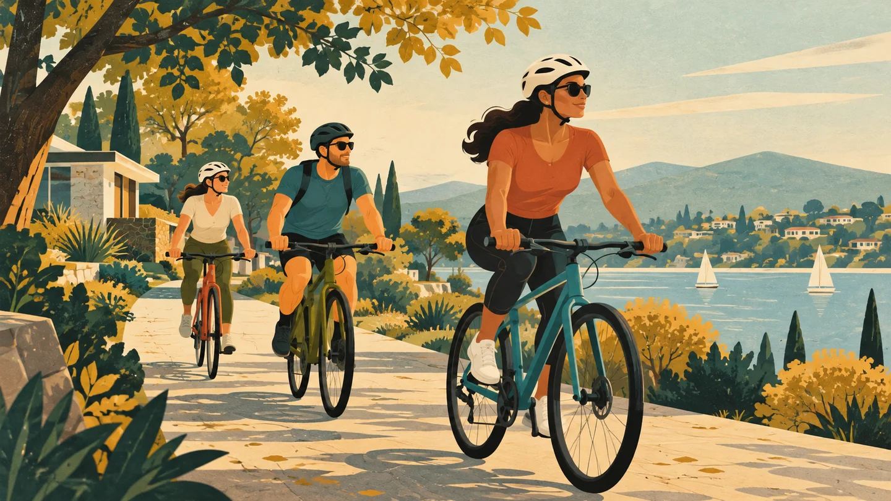
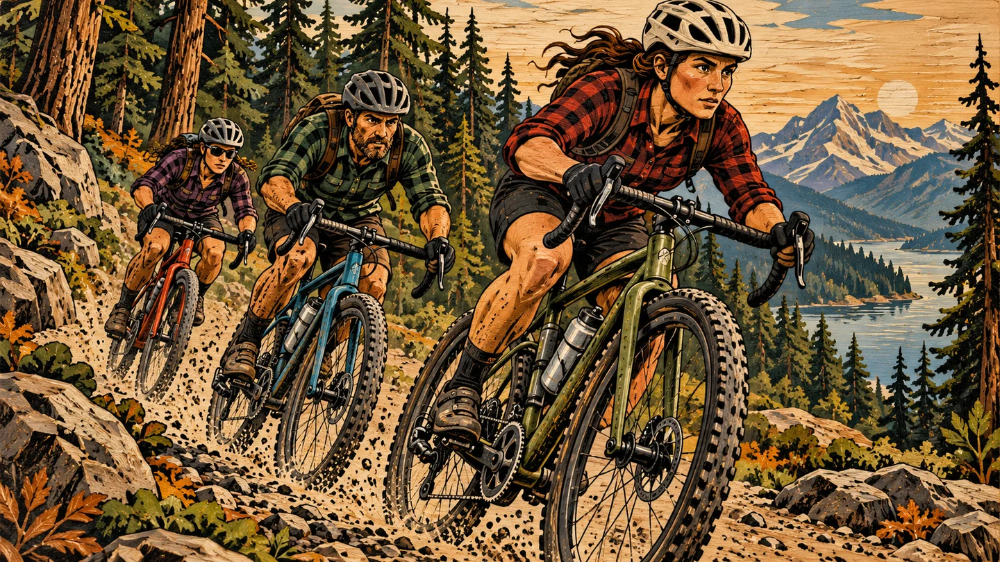
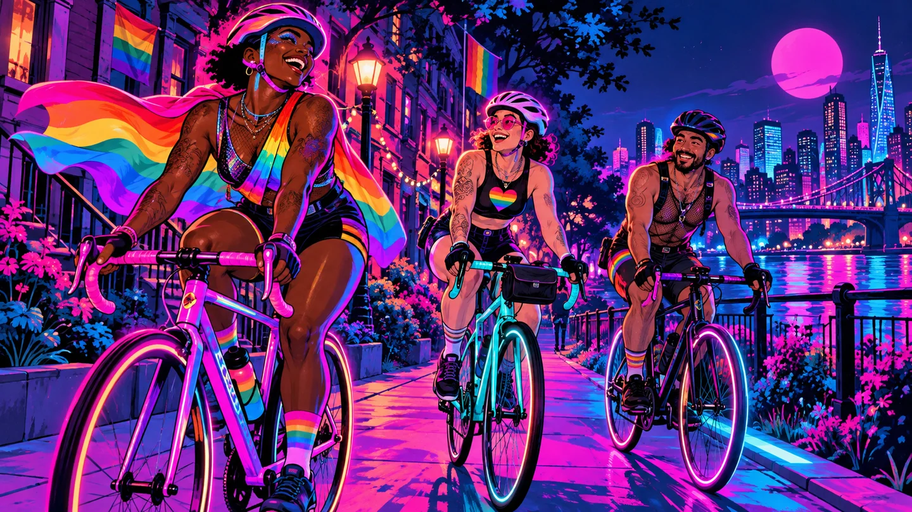

# Image generator direction examples

Generated with the built-in ImageGen tool to compare the requested tone and visual directions. These are concept examples, not outputs from the application's configured image provider. Production prompts also incorporate the actual ride, article, or group brief.

Tone stays separate from style. Flannel and woodwork share Rugged & handcrafted; neon and 80s share 80s neon; Old-timey uses the existing WPA preset. Existing preset IDs remain available.

## mid-century-calm



Prompt:

```
Use case: stylized-concept. Create wide 16:9 community cycling cover art, no text or logos. Three helmeted cyclists on a leafy neighborhood path. Mid-century modern illustration: flat geometric silhouettes, screenprint paper grain, ochre, teal, warm cream, restrained composition. Calm and collected tone: poised riders, spacious balanced layout, quiet confidence. Bicycles must read clearly.
```

## rugged-feisty



Prompt:

```
Use case: stylized-concept. Create wide 16:9 community cycling cover art, no text or logos. Three helmeted cyclists on a forest gravel path. Rugged handcrafted woodcut illustration: carved wood grain, bold ink cuts, earthy colors, subtle flannel pattern on rider clothing, brushed metal bicycle details. Feisty tone: determined expressions, strong forward motion, punchy diagonal composition. Bicycles must read clearly.
```

## neon-pride



Prompt:

```
Use case: stylized-concept. Create wide 16:9 community cycling cover art, no text or logos. Three helmeted cyclists on a city neighborhood path. 1980s neon poster illustration: electric pink cyan violet, luminous graphic contours, deep indigo backdrop, clean readable silhouettes. Flaming fucking gay tone: exuberant queer pride, joyful expressive riders, unapologetic rainbow accents, celebratory movement, dignified inclusive representation without stereotypes. Bicycles must read clearly.
```
